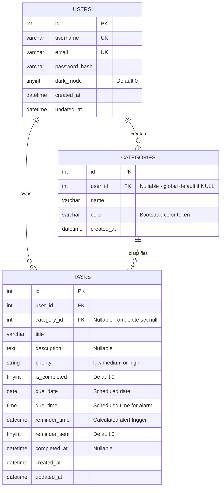
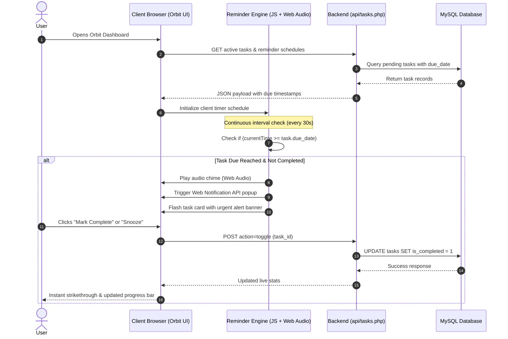
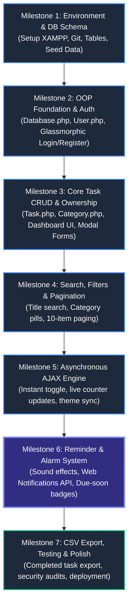

# Project Proposal: Orbit

**A Modern, Fluid Personal Productivity & Task Management Web Application**

---

## 1. Executive Summary

**Orbit** is a personal productivity web application designed to help users streamline daily task management, minimize cognitive clutter, and keep track of daily goals with ease. Built with **PHP (Object-Oriented Programming)**, **MySQL**, **Bootstrap 5.3**, and **modern JavaScript (ES6+ / Fetch API)**, Orbit combines clean relational data architecture with a fluid, dark-mode-first aesthetic.

In addition to core features—such as user authentication, category tagging, priority scoring, 10-item pagination, instant task toggling via AJAX, and CSV exporting—Orbit introduces a **Smart Reminder & Alarm System** that triggers timely browser notifications and audible alarms when tasks reach their scheduled deadlines.

---

## 2. Problem Statement & Motivation

Modern professionals and students face significant daily task overload. Most task trackers either suffer from:
1. **Excessive Complexity**: Bloated enterprise tools (e.g., Jira, ClickUp) that require excessive configuration and induce friction for daily personal tracking.
2. **Lack of Instant Feedback**: Traditional server-rendered web applications that reload the entire page on every interaction, breaking focus.
3. **Missing Timely Alerts**: Simple to-do apps record due dates but fail to actively alert the user when a deadline is imminent, resulting in forgotten deadlines.
4. **Poor Aesthetic & Dark Mode Support**: Inconsistent UI styling that strains the eyes during night work sessions.

**Orbit** solves these problems by providing a lightweight, responsive, and secure platform with fluid micro-animations, real-time background updates, and audio-visual reminders.

---

## 3. Project Objectives

### Primary Objectives
- **Robust OOP Architecture**: Implement clean PHP 8 Object-Oriented principles (encapsulation, single-responsibility models, PDO singleton connection, prepared statements).
- **Strict Data Integrity & Ownership**: Ensure users can strictly access, edit, toggle, and delete only their own tasks (`user_id` ownership validation).
- **Zero-Flicker Interactivity**: Utilize the JavaScript `Fetch API` for asynchronous task status updates, deletion, and dark mode toggling.
- **Smart Reminder & Alarm Engine**: Equip Orbit with visual banner/toast alerts and auditory alarms (using the Web Audio API / HTML5 Audio and Notification API) to alert users to pending and overdue tasks.
- **Actionable Insights & Data Portability**: Provide a real-time progress dashboard (total vs. completed metrics) and one-click CSV export of completed tasks for external reporting.

---

## 4. System Features & Specifications

```
                     ┌───────────────────────────────────────────────┐
                     │                     ORBIT                     │
                     │         Personal Productivity Web App         │
                     └───────────────────────┬───────────────────────┘
                                             │
      ┌──────────────────┬───────────────────┼───────────────────┬──────────────────┐
      ▼                  ▼                   ▼                   ▼                  ▼
┌───────────┐      ┌───────────┐       ┌───────────┐       ┌───────────┐      ┌───────────┐
│   Auth    │      │ Task CRUD │       │ Real-Time │       │  Smart    │      │ Analytics │
│  Module   │      │ & Filter  │       │   AJAX    │       │ Reminders │      │  & Export │
└───────────┘      └───────────┘       └───────────┘       └───────────┘      └───────────┘
 - password_hash    - Priority levels   - Instant toggle    - Browser alert    - Live metrics
 - Session guard    - Category tags     - Dynamic stats     - Audio chime      - Progress bar
 - Glassmorphic UI  - 10-item paging    - Dark mode sync    - Snooze / Ack     - CSV download
```

### 4.1 Authentication & Profile Security
- **Registration & Validation**: Enforces sanitized inputs, unique username/email verification, and minimum password lengths.
- **Cryptographic Security**: Employs PHP's native `password_hash()` (BCRYPT / Argon2) and `password_verify()`.
- **Session Protection**: Hardened against session fixation attacks via `session_regenerate_id(true)`.

### 4.2 Task Management Engine
- **Task Attributes**: Title, detailed description, due date/time, category, and priority (`Low`, `Medium`, `High`).
- **Relational Categorization**: Global default categories (`Work`, `Personal`, `Study`, `Health`) plus user-defined custom categories with color palettes.
- **Ownership Verification**: Database-level and controller-level security verifying `tasks.user_id = session.user_id` before any mutating action.

### 4.3 Search, Filtering & Pagination
- **Search Engine**: Real-time / form search matching task titles and descriptions using SQL parameter-bound `LIKE` queries.
- **Multi-Filter**: Filter by specific category and status (`All`, `Pending`, `Completed`).
- **Preserved Pagination**: 10-item pagination with query string persistence across page shifts.

### 4.4 Smart Reminder & Notification System *(New Key Feature)*
- **Audio Chime & Visual Flash**: When a task's scheduled due time is reached, Orbit plays a soft audio alarm chime and visually highlights the task card.
- **Web Notifications API**: Integrated desktop/browser push notifications that inform the user even if they are working in another tab or application.
- **Reminder Thresholds**: Configurable triggers:
  - *At time of due date/time*
  - *15 minutes before deadline*
  - *Snooze option (remind in 5/10 minutes)*

### 4.5 UI/UX & Dark Mode Customization
- **Glassmorphic Aesthetic**: Ambient floating glow orbs, frosted glass containers (`backdrop-filter: blur`), and micro-interactions.
- **Persistent Dark Mode**: User preference saved directly in MySQL (`users.dark_mode`) and applied synchronously using Bootstrap 5.3's `data-bs-theme`.

### 4.6 Analytics & Data Export
- **Dashboard Stats**: Real-time calculation of Total Tasks, Pending Tasks, Completed Tasks, and Percentage Completion.
- **CSV Data Export**: Single-click export of finished milestones encoded with UTF-8 BOM for Microsoft Excel and Google Sheets compatibility.

---

## 5. Technology Stack

| Layer | Technology | Justification |
| :--- | :--- | :--- |
| **Backend Language** | PHP 8.2+ | Native OOP support, reliable server-side rendering, and low hosting overhead. |
| **Database** | MySQL 8.0 / MariaDB | Relational integrity, foreign key cascading, and indexed search queries. |
| **Frontend Framework** | Bootstrap 5.3 | Responsive grid, accessible utilities, native CSS custom variables, and dark mode engine. |
| **Typography & Icons** | Plus Jakarta Sans & Bootstrap Icons | Modern tech aesthetic and vector icon library. |
| **Client Scripting** | Vanilla JavaScript (ES6+) | Native `Fetch API` for AJAX requests, `Web Audio API` / `Audio()` for alarms, and `Notification API` for push prompts without heavy npm dependencies. |
| **Local Environment** | XAMPP (Apache, MySQL, PHP) | Standardized, cross-platform development environment. |
| **Version Control** | Git & GitHub | Remote code backup, version tracking, and release management. |

---

## 6. Database Architecture

The system utilizes 3 normalized relational tables with clean foreign keys, cascading deletes, and search indexes. To support the upcoming **Smart Reminder & Alarm System**, the `tasks` table includes planned columns (`due_time`, `reminder_time`, `reminder_sent`) alongside existing fields.



---

## 7. Reminder & Task Execution Flow



---

## 8. Implementation Roadmap & Milestones



### Timeline Breakdown:
- **Phase 1 (Completed - Milestones 1 & 2)**: Core database architecture, PDO singleton connection, secure registration/login, glassmorphic UI overhaul with fluid CSS animations, and GitHub sync.
- **Phase 2 (Completed - Milestones 3, 4 & 5)**: Task OOP model, strict user-ownership security checks, search engine, category and status filtering, 10-item pagination, AJAX completion toggling, and live dashboard metrics.
- **Phase 3 (Next Up - Milestone 6: Reminder & Alarm Engine)**:
  - Add `due_time` and `reminder_time` columns to the `tasks` table.
  - Implement client-side JavaScript interval checker (`setInterval`).
  - Synthesize gentle audio chimes via the native `Web Audio API` (no third-party MP3 reliance).
  - Integrate browser desktop push alerts using `Notification.requestPermission()`.
  - Dynamic due status tags: *"Due in 15 mins"*, *"Due Today"*, and *"Overdue"*.
- **Phase 4 (Final Polish - Milestone 7)**: Completed task CSV export optimization, cross-browser compatibility verification, SQL/XSS security hardening audits, and deployment documentation.

---

## 9. Potential Risks & Mitigation Strategies

| Risk | Impact | Mitigation Strategy |
| :--- | :--- | :--- |
| **Browser Audio Autoplay Policies** | Audio chime blocked if user has not interacted with the page yet. | Prompt an initial sound permission toggle or trigger audio initialization on the user's first click anywhere on the dashboard. |
| **Tab Sleeping / Background Inactivity** | Browser throttling timers when the tab is hidden. | Leverage Web Workers or the `Page Visibility API` (`document.visibilityState`) to trigger immediate delta-checks upon refocusing. |
| **SQL Injection & XSS** | Unauthorized data access or defacement. | 100% prepared PDO statements with bound parameters; HTML-escaping (`htmlspecialchars`) on all rendered user outputs. |
| **Unauthorized Action Tampering** | Malicious requests editing someone else's task. | Explicit user ownership verification (`WHERE id = :task_id AND user_id = :session_user_id`) executed at the SQL layer for all modifications. |

---

## 10. Conclusion

**Orbit** delivers a lightweight, secure, and visually appealing personal productivity ecosystem. By combining high-performance PHP OOP with zero-page-reload AJAX interactions, persistent user personalization, and an automated reminder/alarm mechanism, Orbit ensures users stay on top of daily tasks without cognitive clutter.

